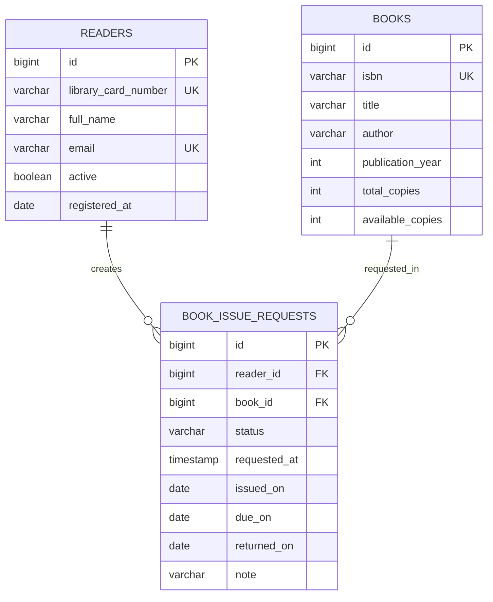

# Спецификация библиотечной информационной системы

## 1. Назначение

Консольное Java-приложение автоматизирует обработку заявок читателей на выдачу книг. Система хранит данные в PostgreSQL, поддерживает полный жизненный цикл заявки, поиск, фильтрацию, сортировку, статистику и экспорт в Excel.

Основная сущность — **заявка на выдачу книги** (`BookIssueRequest`). Связанные сущности — **читатель** (`Reader`) и **книга** (`Book`).

Спецификация охватывает только КР 1: консольное приложение, JDBC и PostgreSQL. JavaFX, Spring, REST API, Android, авторизация, штрафы и уведомления не входят в текущую работу.

### Источники требований

- обязательные функции, архитектурные слои и состав артефактов взяты из предоставленного ТЗ;
- PostgreSQL, Docker, Java 21, три сущности, полный жизненный цикл и срок 30 дней согласованы с заказчиком;
- конкретные бизнес-правила ниже являются правилами проектируемой учебной системы, а не утверждением об универсальных правилах всех библиотек;
- технические решения по JDBC, PostgreSQL и Excel сверены с первичной документацией, указанной в разделе 11.

## 2. Согласованный стек

- Java 21;
- Maven;
- PostgreSQL 18.4 в Docker Compose;
- JDBC без ORM и Spring;
- pgJDBC 42.7.13;
- Apache POI 5.5.1 для `.xlsx`;
- JUnit 5 и Testcontainers для автоматических проверок;
- Maven Shade Plugin для запускаемого JAR.

Версии библиотек фиксируются в `pom.xml`, образ PostgreSQL — в `compose.yaml`.

## 3. Архитектура

```text
Console UI -> Service -> Repository interface -> JDBC implementation -> PostgreSQL
                                  |
                                  +-> Apache POI exporter
```

- `ui` отвечает только за меню, ввод и вывод;
- `service` содержит проверки, бизнес-правила и обработку сценариев;
- `repository` объявляет интерфейсы доступа к данным;
- `repository.jdbc` реализует эти интерфейсы через JDBC;
- `model` содержит предметные классы и enum;
- `exception` содержит собственные исключения;
- `config` создаёт JDBC-подключения из переменных окружения;
- `export` формирует Excel-файл.

SQL не размещается в консольном меню. Зависимости передаются через конструкторы. `Main` только собирает объекты и запускает приложение.

## 4. Предметная модель

### Читатель — `Reader`

| Поле | Тип Java | Ограничение |
|---|---|---|
| `id` | `long` | идентификатор БД |
| `libraryCardNumber` | `String` | обязательно, уникально |
| `fullName` | `String` | обязательно |
| `email` | `String` | обязательно, уникально |
| `active` | `boolean` | признак возможности создавать заявки |
| `registeredAt` | `LocalDate` | дата регистрации |

Поддерживаемые операции: добавить читателя, вывести всех, получить по ID.

### Книга — `Book`

| Поле | Тип Java | Ограничение |
|---|---|---|
| `id` | `long` | идентификатор БД |
| `isbn` | `String` | обязательно, уникально |
| `title` | `String` | обязательно |
| `author` | `String` | обязательно |
| `publicationYear` | `int` | положительное значение |
| `totalCopies` | `int` | не меньше 1 |
| `availableCopies` | `int` | от 0 до `totalCopies` |

Поддерживаемые операции: добавить книгу, вывести все, получить по ID.

### Заявка — `BookIssueRequest`

| Поле | Тип Java | Ограничение |
|---|---|---|
| `id` | `long` | идентификатор БД |
| `readerId` | `long` | внешний ключ на читателя |
| `bookId` | `long` | внешний ключ на книгу |
| `status` | `RequestStatus` | обязательно |
| `requestedAt` | `LocalDateTime` | дата создания |
| `issuedOn` | `LocalDate` | заполняется при выдаче |
| `dueOn` | `LocalDate` | `issuedOn + 30 дней` |
| `returnedOn` | `LocalDate` | заполняется при возврате |
| `note` | `String` | необязательно, не более 500 символов |

Для отображения заявки репозиторий возвращает также имя читателя, название и автора книги; дублировать эти значения в таблице заявок не нужно.

## 5. Статусы и переходы

```text
CREATED -> APPROVED -> ISSUED -> RETURNED
    |          |
    +-> REJECTED
    +-> CANCELLED <-+
```

Точные разрешённые переходы:

- `CREATED -> APPROVED | REJECTED | CANCELLED`;
- `APPROVED -> ISSUED | CANCELLED`;
- `ISSUED -> RETURNED`;
- `RETURNED`, `REJECTED`, `CANCELLED` — конечные статусы.

В Java используется enum `RequestStatus`. В базе статус хранится строкой и ограничивается `CHECK` тем же набором значений.

## 6. Бизнес-правила

1. Нельзя создать заявку без существующих активного читателя и книги.
2. У одного читателя не может быть двух незавершённых заявок на одну книгу одновременно. Активными считаются `CREATED`, `APPROVED`, `ISSUED`.
3. Статус можно изменить только по таблице переходов из раздела 5.
4. Выдать книгу можно только по заявке `APPROVED` и только при `availableCopies > 0`.
5. Выдача атомарно уменьшает `availableCopies` на 1 и задаёт `issuedOn`; `dueOn` вычисляется как `issuedOn.plusDays(30)`.
6. Возврат возможен только из `ISSUED`, атомарно увеличивает `availableCopies` на 1 и задаёт `returnedOn`.
7. Изменять читателя, книгу и примечание можно только у заявки `CREATED`.
8. Удалять можно только заявки в статусах `CREATED`, `REJECTED` и `CANCELLED`; история фактических выдач не удаляется.
9. Обязательные строки после `trim()` не должны быть пустыми; примечание ограничено 500 символами.
10. Количество доступных экземпляров всегда находится в диапазоне от 0 до общего количества.

Правила 1–10 проверяются сервисным слоем. Ограничения, которые можно выразить декларативно, дополнительно защищаются в PostgreSQL. Операции выдачи и возврата выполняются одной транзакцией, чтобы статус заявки и остаток книги не расходились.

## 7. База данных

### Таблицы



Ключевые ограничения:

- `PRIMARY KEY` у всех таблиц;
- `FOREIGN KEY` из заявки на читателя и книгу;
- `NOT NULL` для обязательных данных;
- `UNIQUE` для номера читательского билета, email и ISBN;
- `CHECK` для статуса и количества экземпляров;
- частичный уникальный индекс по `(reader_id, book_id)` для активных заявок;
- индексы по статусу, дате заявки и внешним ключам.

Удаление связанных читателей и книг ограничивается `ON DELETE RESTRICT`.

### Начальные данные

SQL-инициализация создаёт минимум:

- 5 читателей;
- 8 книг с разным количеством экземпляров;
- 10 заявок;
- не менее 3 разных статусов.

Набор данных должен включать доступные и недоступные книги, активные, завершённые и отменённые заявки, а также просроченную выдачу для демонстрации статистики.

## 8. Функции консольного приложения

Главное меню:

```text
================ БИБЛИОТЕЧНАЯ ИНФОРМАЦИОННАЯ СИСТЕМА ================
1. Читатели
2. Книги
3. Заявки на выдачу
4. Поиск заявок
5. Фильтрация заявок
6. Сортировка заявок
7. Статистика
8. Экспорт в Excel
9. Вывести таблицы базы данных
0. Выход
Выберите действие:
```

После каждой операции приложение возвращается в текущее меню. Вложенные меню имеют пункт возврата.

### Заявки

- создать;
- вывести все;
- получить по ID;
- изменить читателя, книгу или примечание у заявки `CREATED`;
- удалить с учётом бизнес-правил;
- изменить статус допустимым переходом.

### Поиск

- по части названия книги без учёта регистра;
- по части ФИО читателя без учёта регистра.

Поиск выполняется параметризованными SQL-запросами с `ILIKE ?`.

### Фильтрация

- по статусу;
- по диапазону дат создания включительно.

### Сортировка

- по дате создания;
- по сроку возврата, при этом заявки без срока располагаются после заявок со сроком.

Для сортировки результатов сервис использует `List`, `Comparator` и Stream API. Направление `ASC`/`DESC` выбирает пользователь.

### Статистика

Выводятся как минимум следующие показатели:

1. количество читателей;
2. количество наименований книг;
3. общее количество экземпляров;
4. количество доступных экземпляров;
5. общее количество заявок;
6. количество заявок по каждому статусу;
7. количество просроченных выдач (`ISSUED` и `dueOn < текущей даты`).

### Экспорт

Создаётся `.xlsx` с листами `Readers`, `Books`, `Requests`, `Statistics`. Файл сохраняется в каталог `exports` с датой и временем в имени. В книге Excel должны быть заголовки, автофильтр, закреплённая строка заголовков, читаемые ширины столбцов и формат дат.

## 9. Обработка ошибок

Программа не завершается после ошибки отдельной операции. Пользователь получает понятное сообщение и возвращается в меню.

Обрабатываются:

- текст вместо числа и значение вне диапазона меню;
- пустые обязательные поля и неверный формат даты;
- отсутствие записи по ID;
- нарушение бизнес-правила;
- нарушение ограничений БД;
- ошибка подключения к PostgreSQL;
- ошибка SQL-запроса;
- ошибка записи Excel-файла.

Собственные исключения:

- `EntityNotFoundException`;
- `BusinessRuleException`;
- `DataAccessException`;
- `ExportException`.

JDBC-ресурсы закрываются через `try-with-resources`. Все значения из пользовательского ввода передаются в `PreparedStatement` параметрами.

## 10. Критерии готовности

Система считается готовой, когда:

- PostgreSQL запускается через Docker Compose и инициализируется SQL-скриптами;
- проект собирается на Java 21 командой `mvn clean package`;
- запускаемый JAR открывает меню и не завершает работу после одной операции;
- все заявленные CRUD-операции над заявкой работают с PostgreSQL;
- поиск, два фильтра и два варианта сортировки дают корректный результат;
- все переходы статусов и бизнес-правила проверяются в сервисе;
- выдача и возврат согласованно меняют заявку и остаток книги;
- статистика выводит минимум 5 показателей;
- экспорт открывается как корректный `.xlsx`;
- SQL содержит требуемые ключи и ограничения;
- в репозитории присутствуют `pom.xml`, SQL-скрипты, ER-диаграмма, Excel-пример и инструкция запуска;
- автоматические тесты и ручной сквозной сценарий проходят успешно.

## 11. Основания технических решений

- Java 21 JDBC: `PreparedStatement` представляет параметризованный предварительно скомпилированный SQL-запрос, а JDBC-ресурсы реализуют `AutoCloseable`.
- PostgreSQL: ссылочная целостность обеспечивается внешними ключами; ограничения `UNIQUE`, `CHECK` и `FOREIGN KEY` подходят для защиты инвариантов данных.
- Транзакции: JDBC-соединение по умолчанию работает с auto-commit, поэтому составные операции выдачи и возврата явно используют `setAutoCommit(false)`, `commit()` и `rollback()`.
- Excel: Apache POI XSSF предназначен для формата `.xlsx`.
- Интеграционные тесты: Testcontainers запускает реальный PostgreSQL в Docker и исключает расхождения с H2.

Проверенные источники:

- [Java 21 `PreparedStatement`](https://docs.oracle.com/en/java/javase/21/docs/api/java.sql/java/sql/PreparedStatement.html)
- [Java 21 `Connection`](https://docs.oracle.com/en/java/javase/21/docs/api/java.sql/java/sql/Connection.html)
- [Java 21 `LocalDate`](https://docs.oracle.com/en/java/javase/21/docs/api/java.base/java/time/LocalDate.html)
- [PostgreSQL: ограничения](https://www.postgresql.org/docs/18/ddl-constraints.html)
- [PostgreSQL: внешние ключи](https://www.postgresql.org/docs/current/tutorial-fk.html)
- [PostgreSQL: блокировки строк](https://www.postgresql.org/docs/17/explicit-locking.html)
- [Официальный образ PostgreSQL](https://hub.docker.com/_/postgres)
- [pgJDBC](https://jdbc.postgresql.org/download/)
- [Apache POI XSSF](https://poi.apache.org/components/spreadsheet/)
- [JUnit 5.14.3](https://docs.junit.org/5.14.3/user-guide/)
- [Maven Compiler Plugin 3.16.0](https://maven.apache.org/plugins/maven-compiler-plugin/)
- [Maven Surefire Plugin 3.6.0](https://maven.apache.org/surefire/maven-surefire-plugin/)
- [Maven Shade Plugin 3.6.2](https://maven.apache.org/plugins/maven-shade-plugin/)
- [Testcontainers с PostgreSQL](https://testcontainers.com/guides/getting-started-with-testcontainers-for-java/)
